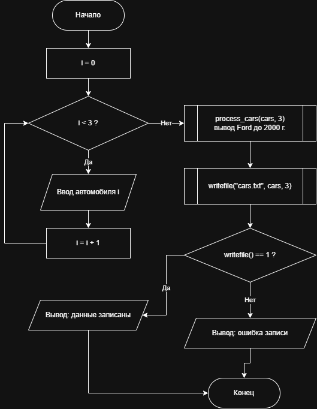

# Домашнее задание к работе 12

## Условие задачи (Вариант 11)

Доработать программу из домашнего задания к работе 11 (структура для хранения записи «Автомобиль»), добавив функцию записи массива структур в текстовый файл.

Поля записи:
- марка автомобиля;
- производитель;
- тип;
- год выпуска;
- дата регистрации.

Требования:
1. Ввести с клавиатуры три структуры типа `Car`.
2. Вывести сведения о машинах марки Ford, зарегистрированных до 2000 года.
3. Реализовать функцию `writefile`, которая открывает файл `cars.txt` в режиме `"wt"`, проверяет успешность открытия, записывает поля каждой структуры массива (строковые значения без пробелов, после каждого `%s` пробел-разделитель, в конце записи перевод строки) и закрывает файл.

---

## 1. Алгоритм и блок-схема

### Алгоритм

1. Задать константы: количество записей `N = 3` и имя выходного файла `FILENAME = "cars.txt"`.
2. Описать структуру `Date` (день, месяц, год) и структуру `Car` (марка, производитель, тип, год выпуска, дата регистрации).
3. Настроить локализацию (`setlocale`) для корректного вывода русского текста.
4. В цикле от 0 до 2 ввести три структуры функцией `input_car`. Строковые поля вводятся через `%s`, поэтому без пробелов.
5. Вызвать функцию `process_cars`: подсчитать и вывести записи марки `Ford` с годом регистрации меньше 2000.
6. Вызвать функцию `writefile(FILENAME, cars, N)`:
   - открыть файл `cars.txt` в режиме `"wt"`;
   - если `out == NULL`, вывести сообщение об ошибке и вернуть `0`;
   - в цикле по всем записям записать поля строкой `fprintf` с пробелами после строковых значений и переводом строки в конце;
   - закрыть файл `fclose` и вернуть `1`.
7. Если `writefile` вернула `1`, вывести сообщение об успешной записи, иначе сообщение об ошибке.
8. Завершить программу.

### Блок-схема

### 

---

## 2. Реализация программы

Исходный код программы: [Source.c](Source.c)

---

## 3. Результаты работы программы

Пример диалога в консоли при вводе 3 записей:

```
Автомобиль 1
Марка автомобиля: Ford
Производитель: Ford
Тип: седан
Год выпуска: 1998
Дата регистрации (день месяц год): 15 3 1999
Автомобиль 2
Марка автомобиля: Toyota
Производитель: Toyota
Тип: хэтчбек
Год выпуска: 2005
Дата регистрации (день месяц год): 1 1 2005
Автомобиль 3
Марка автомобиля: Ford
Производитель: Ford
Тип: универсал
Год выпуска: 2010
Дата регистрации (день месяц год): 10 5 2010

Найдено автомобилей марки Ford, зарегистрированных до 2000 года: 1

Марка: Ford
Производитель: Ford
Тип: седан
Год выпуска: 1998
Дата регистрации: 15.03.1999

Данные успешно записаны в файл cars.txt
```

Содержимое файла `cars.txt`:

```
Марка:Ford ; Производитель:Ford ; Тип:седан ; Год:1998 ; Дата:15.03.1999
Марка:Toyota ; Производитель:Toyota ; Тип:хэтчбек ; Год:2005 ; Дата:01.01.2005
Марка:Ford ; Производитель:Ford ; Тип:универсал ; Год:2010 ; Дата:10.05.2010
```

---

## 4. Информация о разработчике

- **ФИО:** Кочанов Кирилл Романович
- **Группа:** БОТИ-261
